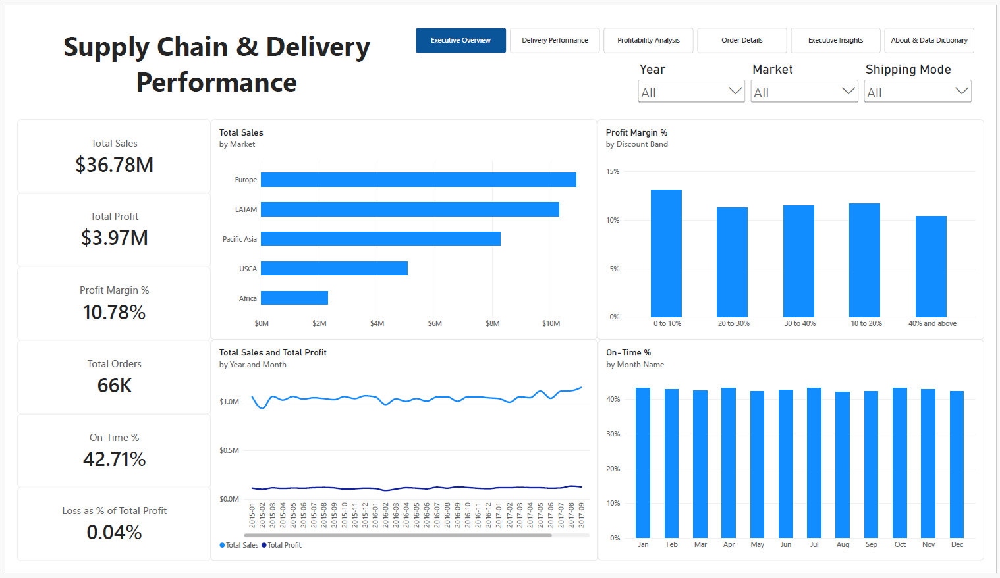
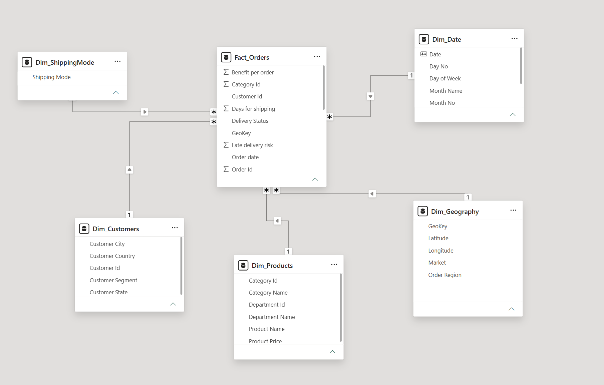
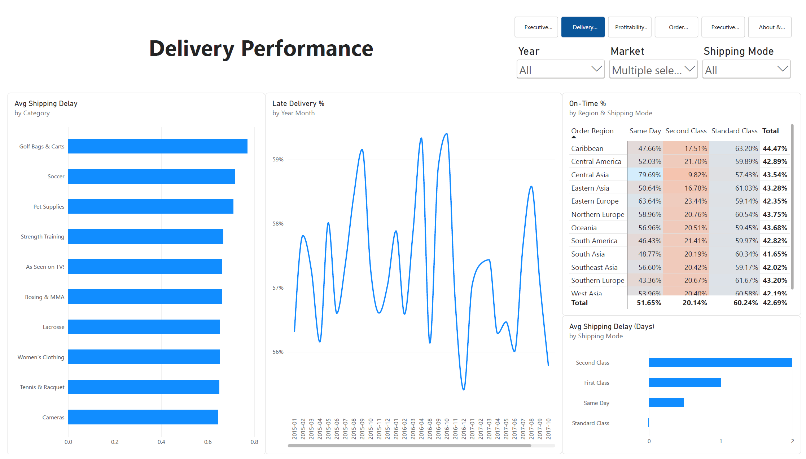
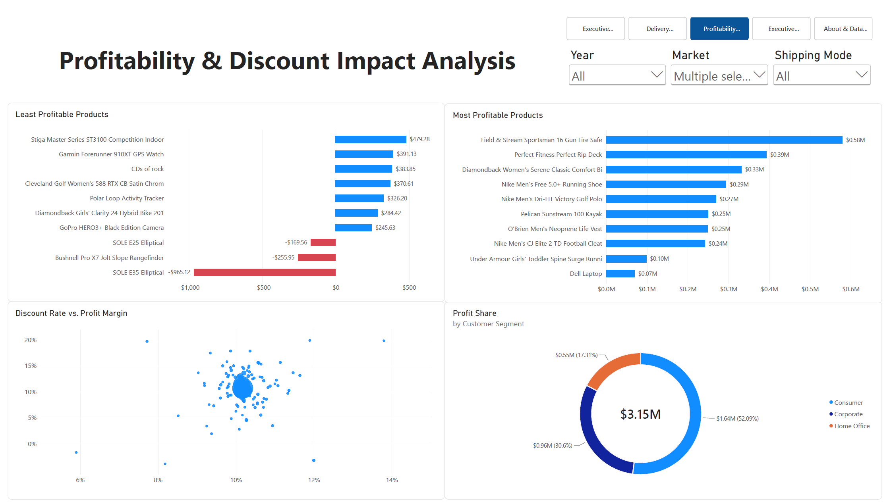
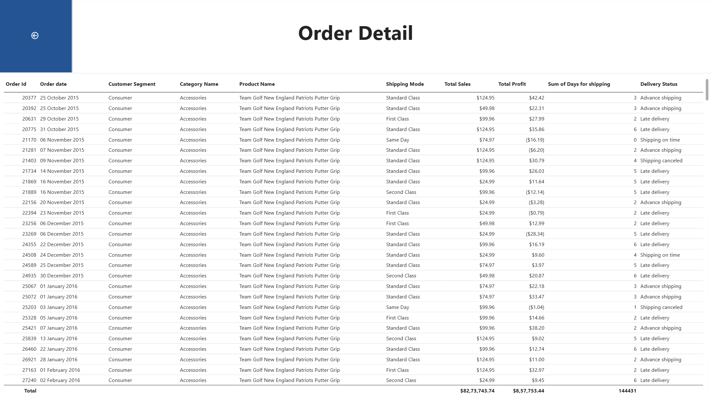

# Supply Chain & Delivery Performance Command Center

A Power BI report that analyses delivery performance, profitability and discount impact across 180,000+ order lines from the DataCo Smart Supply Chain dataset.

> **Headline finding:** only **42.71%** of valid orders arrived on time, and the gap between shipping modes is far larger than any other split in the data. On-time rates were **0.00%** for First Class, **20.17%** for Second Class, **52.07%** for Same Day and **60.23%** for Standard Class.



---

## Business Problem

Operations and finance leaders need to know where deliveries fail, which customer segments drive profit, and whether discounting protects or erodes margin. This report answers three questions:

1. Where and why do orders arrive late?
2. Which segments and products drive profit, and which lose money?
3. How do discount levels relate to profit margin?

## Dataset

- **Source:** DataCo Smart Supply Chain for Big Data Analysis (Kaggle): https://www.kaggle.com/datasets/shashwatwork/dataco-smart-supply-chain-for-big-data-analysis
- **Size:** 180,000+ order lines, about 66K orders, five markets (Europe, LATAM, Pacific Asia, USCA, Africa).
- **Period:** Jan, 2015 to Jan, 2018.
- **Licence:** check the dataset page for its licence terms before redistributing any data.
- **Not included in this repo:** download the CSV from Kaggle and place it in `/data` (see *How to Open*). 

**Personal data:** the source file contains customer name, email, password and street-address columns. These were **removed in Power Query** and are not loaded into the model.

## Data Model

Star schema with one fact table and five dimensions, all one-to-many with single-direction filtering:

- `Fact_Orders`: order-line facts (sales, profit, discount, scheduled and actual shipping days, delivery status)
- `Dim_Customers`, `Dim_Products`, `Dim_Geography`, `Dim_ShippingMode`, `Dim_Date` (marked as the date table)

All measures live in a dedicated `_Measures` table.



## Data Preparation (Power Query)

- Imported the CSV with the correct encoding and converted order dates using the **English (United States)** locale.
- Removed personal-data columns and renamed fields for readability.
- Split the flat file into the fact and dimension tables above.
- Excluded cancelled shipments from all on-time and late-delivery calculations.
- Created a **Discount Band** column for the discount analysis.

## Key Metrics

| Metric | Value |
|---|---|
| Total Sales | \$36.78M |
| Total Profit | \$3.97M |
| Profit Margin | 10.78% |
| Total Orders | 66K |
| On-Time % | 42.71% |
| Loss from loss-making products, as % of profit | 0.04% |

**Definitions**

- **On-Time %:** share of valid (non-cancelled) orders delivered where actual shipping days are less than or equal to scheduled days.
- **Late Delivery %:** share of valid orders that exceeded the scheduled window.
- **Avg Shipping Delay (Days):** average of (actual days minus scheduled days).

```
Avg Shipping Delay (Days) =
AVERAGEX ( Fact_Orders, Fact_Orders[Days for shipping] - Fact_Orders[Scheduled days] )

Profit Margin % = DIVIDE ( [Total Profit], [Total Sales] )
```

## Report Pages

| Page | What it shows |
|---|---|
| Executive Overview | KPI cards, sales and profit by month, sales by market, on-time rate by month, margin by discount band |
| Delivery Performance | On-time % by region and shipping mode, delay by category and shipping mode, late-delivery trend |
| Profitability Analysis | Profit by segment, most and least profitable products, discount impact |
| Order Details | Drill-through to order-level detail |
| Executive Insights | Findings and recommendations |
| About & Data Dictionary | Sources, model and metric definitions |

## Key Findings

1. **Shipping mode drives on-time performance.** First Class had 0.00% on-time delivery across every region and averaged about 1 day late. Second Class reached only 20.17% and had the longest average delay, about 2 days. Standard Class (60.23%) and Same Day (52.07%) performed best.
2. **Lateness is structural, not a one-off.** The monthly late-delivery rate stays in a narrow band around 57% from 2015 onwards, with no visible improvement or deterioration.
3. **Higher discounts are associated with lower margins.** Bands below 40% held margins at about 11% to 13%, while the 40%+ band had the weakest margin. This analysis does not test whether discounts changed order volume.
4. **Profit is concentrated in the Consumer segment:** \$2.07M (52.27%), followed by Corporate at \$1.20M (30.32%) and Home Office at \$0.69M (17.42%).
5. **Product losses are small.** Only 3 products lose money (SOLE E35 Elliptical at -\$965.12, Bushnell Pro X7 Jolt Slope Rangefinder at -\$255.95, SOLE E25 Elliptical at -\$169.56), about \$1.4K in total or 0.04% of profit.

## Recommendations (in priority order)

1. **Review First Class and Second Class delivery promises.** First Class never meets its scheduled window and averages about a day late, which suggests the promise itself may be unrealistic. Investigate scheduled days vs carrier performance before renegotiating contracts.
2. **Add a discount guardrail for deep discounts.** Require approval for discounts in the 40%+ band, where margin is weakest. Test the effect on volume before rolling it out.
3. **Housekeeping on the three loss-making products.** Reprice or review supplier cost. The financial impact is minor.

These are hypotheses suggested by the data, not proven causes.

## Limitations

- DataCo is a published sample dataset, so findings illustrate the analysis and do not describe a real company.
- Results are descriptive and show association only. No statistical tests were run.
- Regional and shipping-mode cells with few orders can be unstable.
- On-time status uses the scheduled and actual days recorded in the source data.
- Cancelled shipments are excluded from delivery metrics but not from every sales view. See the About page for each metric's scope.

## How to Open

1. Download the dataset from Kaggle and place the CSV in `/data` (file name as in the Power Query source step).
2. Open `Supply Chain & Delivery Performance.pbix` in Power BI Desktop (Windows).
3. If prompted, point the Power Query source to your local CSV path and refresh.

## Repository Structure

```
.
|-- README.md
|-- pbix
|   |-- Supply Chain & Delivery Performance.pbix
|-- images/
|   |-- delivery.png
|   |-- details.png
|   |-- insights.png
|   |-- executive.png
|   |-- model.png
|   |-- overview.png
|   |-- profit.png
|-- docs/
|   |-- Supply Chain & Delivery Performance.pdf
```

## Skills Demonstrated

Power Query (M), star-schema modelling, DAX (time intelligence, `CALCULATE`, `AVERAGEX`, `DIVIDE`), KPI design, drill-through, page navigation, data privacy handling, and documenting assumptions.

## Images





## Author

Dhawan Singh Saini | [LinkedIn](https://linkedin.com/in/dhawan-singh-saini)