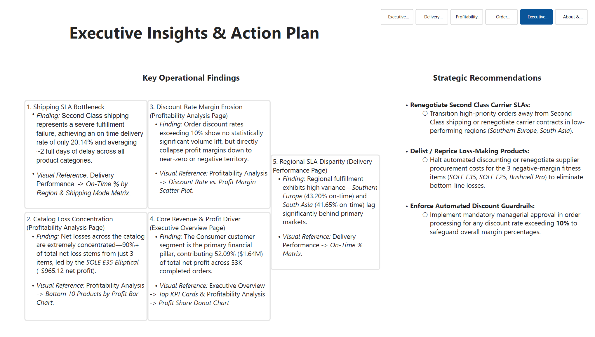
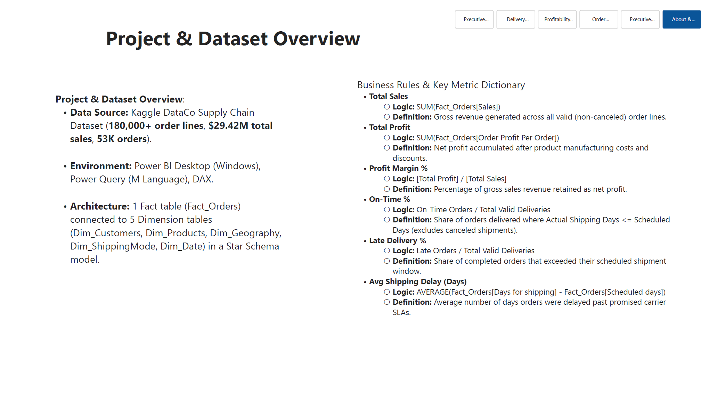

# Supply Chain & Delivery Performance Command Center

An enterprise-grade Power BI analytics solution designed to monitor global supply chain operations, evaluate regional carrier SLA compliance, diagnose catalog loss drivers, and eliminate profit margin erosion caused by unconstrained discounting strategies.

---

## 📌 Executive Summary

* **Dataset Scale:** $180,000+$ granular order lines aggregated across **53,000+** unique completed orders.
* **Financial Footprint:** **\$29.42M** in gross sales revenue generating **\$3.15M** in net profit (Overall Profit Margin: $10.71\%$).
* **Fulfillment Performance:** Overall On-Time Delivery Rate of **42.69%**, driven down primarily by shipping SLA bottlenecks.
* **Core Operational Bottleneck:** **Second Class shipping** represents a severe fulfillment failure, achieving an on-time delivery rate of only **20.14%** and averaging **\~2 full days of delay** across all product categories.
* **Profit Loss Drivers:** Catalog net losses are heavily concentrated—**$90\%+$ of total catalog net loss** stems from just 3 items, led by the *SOLE E35 Elliptical* ($- \$965.12$ net profit).

---

## 📁 Repository Structure

```text
Supply Chain & Delivery Performance/
├── data/
│   └── DataCoSupplyChainDataset.csv
├── docs/
│   └── Supply Chain & Delivery Performance.pdf
├── images/
│   ├── delivery.png
│   ├── details.png
│   ├── executive.png
│   ├── insights.png
│   ├── model.png
│   ├── overview.png
│   └── profit.png
├── pbix/
│   └── Supply Chain & Delivery Performance.pbix
└── README.md
```

---

## 📐 Data Architecture & Star Schema Model

The data model follows a **Star Schema** design optimized for DAX aggregation performance and seamless cross-filtering across dimensions.


### Schema Components:
* **Fact Table:** `Fact_Orders` (contains core transactional metrics, sales values, shipping dates, and profit margins).
* **Dimension Tables:** `Dim_Customers`, `Dim_Products`, `Dim_Geography`, `Dim_ShippingMode`, and `Dim_Date`.
* **Composite Key Resolution:** Engineered a composite key `GeoKey` (`Order City` + `Order State` + `Order Country`) across `Dim_Geography` and `Fact_Orders` to eliminate city name collisions across international borders.

---

## 🖥️ Interactive Dashboard Walkthrough

### 1. Executive Overview
Focuses on macro-level business performance, revenue distribution across global markets, and top-level delivery SLAs.


* **Key Indicators:**
  * **Total Sales:** \$29.42M
  * **Total Profit:** \$3.15M
  * **Profit Margin %:** $10.71\%$
  * **Total Orders:** 53K
  * **On-Time %:** $42.69\%$

---

### 2. Delivery Performance Analysis
Monitors operational carrier SLAs, identifies delays across product categories, and highlights regional fulfillment bottlenecks.


* **Key Operational Findings:**
  * **Second Class Failure:** Achieves an on-time rate of only **20.14%** compared to **60.24%** for Standard Class and **51.65%** for Same Day.
  * **Regional Disparities:** Fulfillment lags behind in *South Asia* (**41.65% on-time**) and *Southern Europe* (**43.20% on-time**).
  * **Category Impact:** *Golf Bags & Carts*, *Soccer*, and *Pet Supplies* experience the highest average shipping delay days.

---

### 3. Profitability & Discount Impact Analysis
Evaluates product margin performance, isolates catalog loss leaders, and measures the mathematical impact of discounting on net margins.


* **Key Financial Findings:**
  * **Core Pillar:** The **Consumer** segment is the primary profit engine, contributing **52.09% (\$1.64M)** of total net profit.
  * **Loss Concentration:** Over **$90\%$ of catalog losses** originate from 3 items: *SOLE E35 Elliptical* ($- \$965.12$), *Bushnell Pro X7 Jolt Rangefinder* ($- \$255.95$), and *SOLE E25 Elliptical* ($- \$169.56$).
  * **Discount Erosion:** Discount rates exceeding **10%** provide no significant sales volume lift while directly driving profit margins into negative territory.

---

### 4. Executive Insights & Action Plan
Translates analytical charts into C-suite commentary and structured strategic recommendations.



---

### 5. Order Details (Transaction Audit & Drill-Through)
Granular order-level audit page supporting drill-through interactions from executive visuals to individual transaction records.


---

### 6. Project & Dataset Overview (Data Dictionary)
Documents project metadata, Star Schema architecture, metric DAX formulas, and Power Query ETL steps for technical stakeholders.



---

## 📊 Key Metrics & DAX Logic Dictionary

| Metric Name | Business Logic / DAX Calculation Formula | Definition |
| :--- | :--- | :--- |
| **Total Sales** | `SUM(Fact_Orders[Sales])` | Gross sales revenue generated across non-canceled orders. |
| **Total Profit** | `SUM(Fact_Orders[Order Profit Per Order])` | Net profit retained after item costs and discounts. |
| **Profit Margin %** | `[Total Profit] / [Total Sales]` | Percentage of gross revenue retained as net profit. |
| **On-Time %** | `Count(On-Time Deliveries) / Count(Valid Deliveries)` | Proportion of orders delivered where $\text{Actual Days} \le \text{Scheduled Days}$. |
| **Late Delivery %** | `Count(Late Deliveries) / Count(Valid Deliveries)` | Proportion of completed shipments that exceeded promised carrier SLAs. |
| **Avg Shipping Delay** | `AVERAGE(Fact_Orders[Days for shipping] - Fact_Orders[Scheduled days])` | Average excess delay in days past target carrier SLA. |

---

## 🛠️ Data Transformation & ETL Pipeline

All data preparation steps were implemented in **Power Query (M Language)**:

1. **Text Encoding Repair:** Re-encoded raw CSV import from `CP1252` to `UTF-8` to fix corrupted special characters in international order cities and product names.
2. **PII Anonymization:** Redacted sensitive customer data fields (Customer Email, Password, Street Address, First/Last Name) to ensure compliance with data privacy standards.
3. **Date & Calendar Normalization:** Parsed composite timestamps into clean `Date` types linked to a custom DAX `Dim_Date` table.
4. **Geography Deduplication:** Built `GeoKey` (`City + State + Country`) to resolve duplicate city name errors across global markets.

---

## 🎯 Strategic Business Action Plan

1. **Renegotiate Second Class Carrier SLAs:**
   * Transition high-priority shipments away from Second Class carriers or renegotiate SLAs in low-performing regions (*Southern Europe*, *South Asia*).
2. **Delist or Reprice Loss-Making Products:**
   * Halt automated discounting and adjust pricing or renegotiate procurement costs for the bottom 3 profit-draining items (*SOLE E35*, *SOLE E25*, *Bushnell Pro*).
3. **Automate Discount Guardrails:**
   * Implement mandatory managerial approval in order management systems for any order discount rate exceeding **10%**.
